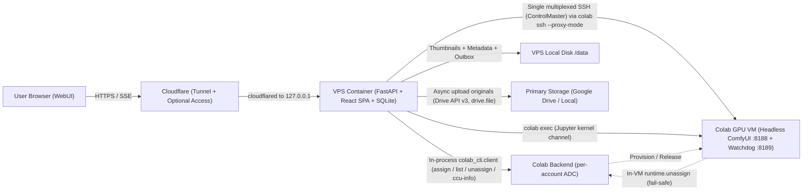
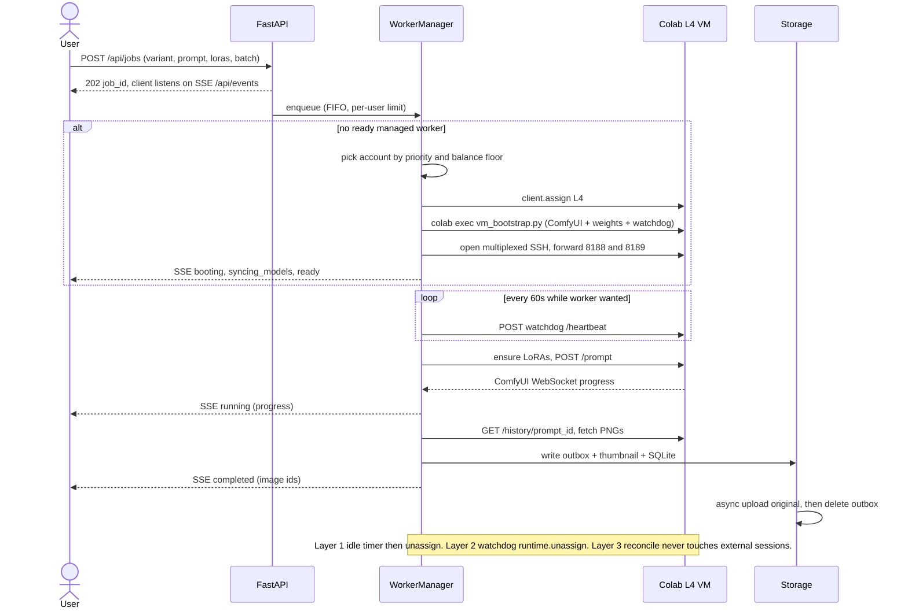

# `colab-canvas` 系统架构设计

> **项目定位**：Bring Your Own Paid Colab Accounts — Self-Hosted AI Art Studio & Colab GPU Pool
> **代码仓库**：`github.com/chius-me/colab-canvas`
> **文档状态**：MVP v0.1 架构 · rev.2（已按 `google-colab-cli` 0.8.0 源码审计修订，待 Phase 0 实测回填）

---

## 1. 项目定位与核心原则

`colab-canvas` 是一个自托管的 AI 绘图工作台：常驻 WebUI 运行在一台小 VPS 上，GPU 算力按需从使用者**自己的付费 Google Colab 账号**里临时借用，成图归档到一个统一的主存储（Google Drive 或本地磁盘）。

### 核心原则

1. **控制面常驻、算力面按需**：控制面（FastAPI + SQLite + React SPA）单容器常驻（预期 ~150–250 MB 内存）；没有任务时 **0 台活跃 Colab VM = 0 CU/h**。浏览画廊、改参数、看队列都不会触发开机。
2. **算力账号与存储账号解耦**：Colab 账号只提供临时 GPU；原图统一写入**唯一主存储**，控制面本地只保留 WebP 缩略图、SQLite 元数据和待上传的 outbox。
3. **全链路异步**：`POST /api/jobs` 立即返回 `job_id`，进度通过 SSE 推送，规避 Cloudflare 100 秒超时（524）。
4. **失败默认安全（Fail-safe Billing）**：任何一环（控制面崩溃、VPS 重启、网络中断）失效，都必须有**另一层**保证 GPU 被释放；且绝不误停使用者手动开的 Colab 会话。

> [!WARNING]
> **服务条款风险（已知、接受、需明示）**：Colab 条款不允许“使用多个账号规避资源限制”，并对把运行时作为 Web 服务对外提供有限制。因此：
> - 默认调度为**轮换（Rollover）**：一个账号余额低于底线才切到下一个，**不做跨账号并发**；
> - README 明确要求每个账号必须是**使用者本人的付费订阅**；
> - 触发风控时的典型后果是对应账号 Colab 受限，部署者需自行评估。

---

## 2. 总体系统拓扑



---

## 3. 核心子系统设计

### 3.1 Colab Gateway & Account Pool（多账号算力池）

**审计结论**：`colab --config` **只隔离 `sessions.json`**。以下路径在 0.8.0 中写死于 `~`，多账号共用会串台：`~/.config/colab-cli/settings.json`、`~/.config/colab-cli/history/<session>.jsonl`、`~/.config/colab-cli/colab.log`（DEBUG 级、无轮转），以及 `~/.ssh/id_ed25519.pub` 公钥查找。因此采用 **“库优先 + 子进程 HOME 隔离”**：

- **控制类操作走进程内库调用**（不起子进程、不解析 stdout）：
  ```python
  from google.oauth2.credentials import Credentials
  from google.auth.transport.requests import AuthorizedSession
  from colab_cli.client import Client, Prod

  creds = Credentials.from_authorized_user_info(decrypted_adc_json)  # 每账号一份
  client = Client(Prod(), AuthorizedSession(creds))
  client.assign(...)                     # 开机（L4 等）
  client.list_assignments()              # 对账
  client.unassign(endpoint)              # 停机
  client.get_consumption_user_info()     # 余额 / 消耗速率 / 活跃分配数
  ```
  `colab_cli.client` 是**内部 API**：依赖锁定 `google-colab-cli==0.8.0`，升级前必须重跑 Phase 0 的集成脚本。全部调用封装在 `backend/app/colab/gateway.py`，业务层不直接 import `colab_cli`。
- **只有 SSH 代理需要子进程**，并强制每账号独立 HOME：
  ```bash
  HOME=/data/accounts/<id>/home \
  GOOGLE_APPLICATION_CREDENTIALS=/data/accounts/<id>/home/adc.json \
    python -m colab_cli.cli --auth adc --config /data/accounts/<id>/home/sessions.json \
    ssh --proxy-mode -s <session> --identity /data/ssh/id_ed25519
  ```
  每个账号 HOME 下预置 `settings.json`：`{"enable_update_check": false}`（否则每日升级横幅会写入 stdout）；`colab.log` 由后台任务按大小轮转。
- **凭据**：Authorized User ADC JSON，按下列 scopes 签发（`openid`、`cloud-platform` 是 gcloud 自身要求，`userinfo.email` 是 session backend 要求）：
  ```bash
  gcloud auth application-default login \
    --scopes=openid,https://www.googleapis.com/auth/cloud-platform,https://www.googleapis.com/auth/userinfo.email,https://www.googleapis.com/auth/colaboratory
  ```
  这份 JSON 持有 `cloud-platform` 级刷新令牌，**等同账号 GCP 全权**：入库时用 `CANVAS_SECRET_KEY`（Fernet）加密，只在需要时解密到账号 HOME（`0600`），任何 API 都不返回其内容，仅管理员可导入。
- **调度（轮换）**：按管理员设定的 `priority` 选第一个健康账号；`balance < min_balance_cu`（默认 `5.0`）的账号不再用于新开机。余额轮询：空闲时每 10 分钟，有活跃 Worker 时每 1 分钟。
- **开机错误映射**（来自 `client.assign` 行为）：
  | 后端返回 | 含义 | 处理 |
  | :--- | :--- | :--- |
  | `412`（`TooManyAssignmentsError`） | 活跃会话过多 / 临时容量不足 | 换下一个账号重试；全部失败则任务保持排队并在 SSE 提示“GPU 暂不可用” |
  | `400` | 该账号无此卡权限 | 账号标记 `unsupported_gpus += [L4]`，换下一个账号 |
  | `502/503/504` / 读超时 | 后端抖动 | 库内支持重试，建议设 `COLAB_CLI_ASSIGN_RETRIES=5`（实测偶发 503，默认 3 偏低） |
  - **禁止回退到 T4**（不支持原生 BF16，Anima 会极慢）；可选回退顺序 `L4 → A100`，由管理员开关控制。

### 3.2 Worker Manager & Cost Guard（按需启停与三层防烧钱）

- **单 Worker + 全局 FIFO**：MVP 全局最多 1 台活跃 GPU（默认 L4，约 `1.54 CU/h`），所有用户任务排队复用同一台暖机 VM。
- **冷启动流水线**：
  1. `client.assign(GPU, L4)` → 记录 `workers(endpoint, account_id, origin=managed)`。
  2. **Bootstrap 走 `colab exec`（Jupyter kernel 通道，不占 SSH 连接）**：执行 `scripts/vm_bootstrap.py`：
     - `git clone` ComfyUI 并 checkout **锁定的 commit**；`pip install -r requirements.txt` 时**排除 torch/torchvision/torchaudio**（复用 Colab 预装 CUDA torch，避免重装数 GB）；
     - 用 `huggingface_hub`（开启 `HF_XET_HIGH_PERFORMANCE=1`；`HF_HUB_ENABLE_HF_TRANSFER` 已弃用）**只下载本次请求所需的变体**（见 3.3）到 `/content/ComfyUI/models/`；
     - 后台启动 ComfyUI（`--listen 127.0.0.1 --port 8188`）；
     - **从 kernel 内 `subprocess.Popen` 启动 Watchdog**，使其继承 kernel 的运行时环境变量（含 `TBE_RUNTIME_ADDR`，SSH 启动的进程不一定有）。
  3. 建立**唯一一条**复用的 SSH 连接（见下），同时转发 `8188`（ComfyUI）与 `8189`（Watchdog）。
- **SSH：单连接复用**。0.8.0 源码中 SSH 并发上限为 `_MAX_SSH_SESSIONS = 5`，服务端还会按套餐返回 `429 already-active-session`（可能只允许 1 条）。因此：
  ```bash
  ssh -N -M -S /data/run/<worker>.sock \
      -i /data/ssh/id_ed25519 -o IdentitiesOnly=yes \
      -o StrictHostKeyChecking=no -o UserKnownHostsFile=/dev/null -o LogLevel=ERROR \
      -o ControlPersist=no -o ServerAliveInterval=15 -o ServerAliveCountMax=4 \
      -o ExitOnForwardFailure=yes \
      -o ProxyCommand="<3.1 中的 HOME 隔离 proxy 命令>" \
      -L 127.0.0.1:<p1>:127.0.0.1:8188 -L 127.0.0.1:<p2>:127.0.0.1:8189 \
      root@colab-runtime
  ```
  *（注：实测必须设 `ControlPersist=no`，否则 `-N -M -S` 会后台派生并让父 `ssh` 进程以 `rc=0` 立即退出，导致进程守护误判断连。）*
  后续需要的远程命令（如拉 LoRA）复用 `-S <sock>`；能走 `colab exec` 的优先走 kernel。隧道守护协程断线后指数退避重连（重连前由库刷新 runtime proxy token）。
- **三层防烧钱（Cost Guard）**：
  1. **控制面空闲计时**：队列清空后倒计时（默认 15 分钟，可配置）→ `client.unassign(endpoint)`。
  2. **VM 内 Watchdog（`scripts/vm_watchdog.py`）**：在 `127.0.0.1:8189` 提供 `POST /heartbeat`、`GET /status`。控制面在“希望 VM 存活”期间每 60 秒发心跳。触发条件：**心跳中断超过 `WATCHDOG_TIMEOUT`（默认 20 分钟）且 ComfyUI `/queue` 为空**，或超过**硬上限 `MAX_LIFETIME`（默认 6 小时）**。触发动作：调用 `google.colab.runtime.unassign()`（底层即 `POST http://$TBE_RUNTIME_ADDR/unassign`）**释放分配**——仅杀 ComfyUI 进程**不会**停止计费。
  3. **对账（Reconcile）**：控制面启动时及每 5 分钟，对每个账号 `list_assignments()` 与 `workers` 表比对：
     - 表中有、后端无 → 标记 `stopped`；
     - 表中 `managed` 且超时无心跳 → `unassign`；
     - **后端有、表中无 → 标记为 `external`，只在界面展示，绝不自动停机**（避免误杀使用者手动开的 notebook）。
  - 外加界面上的 **Emergency Stop**（只对 `managed` Worker 生效）以及实时余额 / 运行时长 / 消耗速率。

### 3.3 Workflow Registry（插件化 ComfyUI 工作流）

```text
workflows/
└── anima/
    ├── manifest.yaml        # 变体、权重来源、GPU 要求、表单 Schema、节点绑定规则
    └── workflow_api.json    # ComfyUI API Format 图
```

- **一个包、变体做成参数**：`variant` 枚举，权重均来自 Hugging Face `circlestone-labs/Anima`（`split_files/` 布局）：
  | 变体 | DiT 文件 | 默认参数 | 用途 |
  | :--- | :--- | :--- | :--- |
  | `turbo`（默认抽卡） | `diffusion_models/anima-turbo-v1.1.safetensors` | 8–12 步，CFG=1 | 高频快速出图 |
  | `aesthetic`（默认精修） | `diffusion_models/anima-aesthetic-v1.1.safetensors` | 约 30 步 | 日常高质量出图 |
  | `base`（管理员可见） | `diffusion_models/anima-base-v1.0.safetensors` | 约 30–35 步 | 未精调底模，多用于 LoRA 训练 / 对照 |
  | 公共 | `text_encoders/qwen_3_06b_base.safetensors`、`vae/qwen_image_vae.safetensors` | — | 所有变体共用 |
  具体文件名与版本在 Phase 0 落定后写死进 `manifest.yaml`（含 SHA256），升级需显式改 manifest。
- **按需拉取**：Worker 记录已缓存的文件；切换变体时只补下缺失文件。
- **提示词说明**：Anima 使用 Qwen3-0.6B 文本编码器，`(tag:1.3)` / `((tag))` 这类 CLIP 权重语法**不生效**，前端在输入框给出提示，建议 Danbooru 标签 + 自然语言混写。
- **LoRA**：只有**管理员**可登记 LoRA（来源限 Hugging Face / Civitai，Civitai 令牌走环境变量），普通用户只能从已登记列表中选择；文件名清洗、单文件大小上限；执行前按需下载到 `/content/ComfyUI/models/loras/`，在提交前 patch 进 `workflow_api.json`（支持强度与多 LoRA 串联）。
- **扩展**：新模型（Z-Image-Turbo、FLUX.2 [klein]、Qwen-Image、Hires Fix……）= 新增一个 `workflows/<id>/` 目录，前端按 Schema 自动渲染。

### 3.4 Storage Adapter（双层存储 + Outbox）

- 接口：`put_original(key, stream)`、`get_stream(key, range=None)`、`delete(key)`；实现：`GoogleDriveStorage`、`LocalStorage`。
- **不使用 `colab drivemount`**：它需要交互授权，且会把文件绑到各个临时算力账号。
- **资产流转（Outbox 模式，不丢图）**：
  1. ComfyUI 出图 → 经隧道拉回 PNG，写入 `/data/outbox/<image_id>.png`（保留完整 PNG 元数据）；
  2. 生成 WebP 缩略图（约 30–80 KB）到 `/data/thumbs/`，写 SQLite（`upload_state=pending`），SSE 通知前端；
  3. 后台上传器把 outbox 推送到主存储，成功后回写 `storage_key` 并置 `upload_state=uploaded`，**确认后才删除 outbox 文件**；失败指数退避重试，超过阈值置 `failed` 并在管理面板告警；
  4. 查看/下载原图：若仍在 outbox 直接读本地，否则从主存储流式透传（支持 HTTP Range）。
- **Google Drive 授权方案（解决 7 天过期）**：
  - **首选**：自建 GCP OAuth 客户端（Desktop 类型），**只申请 `https://www.googleapis.com/auth/drive.file`**，并把 OAuth 同意屏幕发布为 **In production**。“Testing” 状态才有 7 天刷新令牌过期；`drive.file` 属于非敏感 scope，预期无需 Google 审核（**Phase 0 必须实测确认**）。
  - `drive.file` 只能访问**本应用创建的文件**：根目录（如 `colab-canvas/`）必须由应用自己创建并记录 `root_folder_id`，不能写入用户手动建的文件夹。
  - 未验证通过前：自动降级为 `LocalStorage` 并在面板提示。

### 3.5 Auth & Quota（双模式鉴权与配额）

| `AUTH_MODE` | 行为 | 适用场景 |
| :--- | :--- | :--- |
| `cloudflare` | 校验 `Cf-Access-Jwt-Assertion`（团队 JWKS 验签，**同时校验 `aud` 与团队域名**），读取邮箱，首次访问自动建用户 | Cloudflare Zero Trust 后的私人部署 |
| `local` | 内置多用户：首个管理员由环境变量/初始化向导创建；邀请码注册；Argon2 + HttpOnly 签名 Cookie | 通用开源自托管 |
| `hybrid`（默认） | 有合法 CF Access JWT 则直接放行，否则走内置登录 | 自用 + 开源两不误 |

- **网络边界**：容器只监听 `127.0.0.1` 或仅暴露给 compose 内网中的 `cloudflared`，**不发布到 `0.0.0.0`**，避免绕过 Cloudflare 伪造请求头。
- **配额护栏**：单次批量上限 4；每人同时排队任务上限 2；每日出图配额；GPU 档位权限（普通用户默认只用 L4）。
- **SSE 规范**：响应头 `Cache-Control: no-cache`、`X-Accel-Buffering: no`；每 15–30 秒发送 `: ping` 心跳注释，防止 Cloudflare 空闲断连；前端断线自动重连并带 `Last-Event-ID` 补发。

### 3.6 Frontend 架构与视觉规范

- **技术栈**：React 19 + Vite + TypeScript + Tailwind CSS v4 + shadcn/ui（Radix）+ Lucide；构建产物由 FastAPI 托管（`/assets` + SPA fallback）。
- **视觉（现代极简工具风 × 轻日系柔色画室感）**：浅暖纸底 `#FAF9F6`、白卡片、1px 细线 `#E7E5E0`、深墨灰文字、低饱和点缀色（浅岩蓝 / 淡樱灰）；以作品为视觉中心，优先使用标准 shadcn/ui 组件，不堆砌自定义 CSS。
- **三大视图**：
  1. **Studio**：变体切换（Turbo / Aesthetic）、正负提示词（附 Anima 语法提示）、比例预设、Steps / CFG / Seed、Batch 1–4、LoRA 选择；右侧显示冷启动阶段时间轴、排队位置与采样进度。
  2. **Gallery**：WebP 瀑布流，按用户 / 变体 / 收藏筛选；Lightbox 展示完整参数、原图下载、上传状态，以及“同款再画（Remix）”。
  3. **Pool & Admin**：账号余额卡片、`managed` / `external` 会话区分、Emergency Stop、队列监控、LoRA 登记、邀请码与配额管理。

---

## 4. 数据模型与生成时序

### 4.1 SQLite Schema 草案

| 表 | 关键字段 |
| :--- | :--- |
| `users` | `id`, `email`, `username`, `password_hash`, `role`, `daily_quota`, `max_queued`, `allowed_gpus`, `created_at` |
| `invite_codes` | `code`, `created_by`, `max_uses`, `used_count`, `expires_at`, `disabled` |
| `colab_accounts` | `id`, `label`, `email`, `cred_encrypted`, `home_dir`, `priority`, `min_balance_cu`, `unsupported_gpus`, `last_balance_cu`, `last_rate_hr`, `last_assignments`, `enabled`, `last_checked_at` |
| `workers` | `id`, `account_id`, `endpoint`, `session_name`, `origin`（`managed`/`external`）, `gpu_type`, `status`（`assigning`/`bootstrapping`/`ready`/`stopping`/`stopped`/`error`）, `comfy_port`, `watchdog_port`, `cached_files`, `started_at`, `last_heartbeat_at`, `last_activity_at`, `stopped_at` |
| `jobs` | `id`, `user_id`, `worker_id`, `workflow_id`, `variant`, `params_json`, `status`（`queued`/`booting`/`running`/`completed`/`failed`/`cancelled`）, `comfy_prompt_id`, `progress`, `error_msg`, `created_at`, `finished_at` |
| `images` | `id`, `job_id`, `user_id`, `workflow_id`, `variant`, `thumb_path`, `outbox_path`, `upload_state`（`pending`/`uploaded`/`failed`）, `storage_backend`, `storage_key`, `width`, `height`, `seed`, `meta_json`, `is_favorite`, `created_at` |
| `loras` | `id`, `name`, `source_type`, `source_url`, `filename`, `sha256`, `size_bytes`, `default_weight`, `trigger_words`, `created_by`, `created_at` |
| `app_settings` | `key`, `value_json`, `updated_at`（含 Drive `root_folder_id`、加密的 Drive token） |

### 4.2 端到端生成时序



---

## 5. API 与实时事件契约（草案）

| 分组 | 端点 | 说明 |
| :--- | :--- | :--- |
| Auth | `GET /api/auth/me`；`POST /api/auth/login`、`/register`、`/logout` | 登录态、鉴权模式、剩余配额；邀请码注册 |
| Workflows & LoRAs | `GET /api/workflows`；`GET /api/loras`；`POST/DELETE /api/loras`（管理员） | 表单 Schema；LoRA 列表与登记 |
| Jobs | `POST /api/jobs`；`GET /api/jobs`、`/api/jobs/{id}`；`POST /api/jobs/{id}/cancel` | 提交、查询、取消排队任务 |
| Gallery | `GET /api/images`；`GET /api/images/{id}/thumb`；`GET /api/images/{id}/original`（支持 Range）；`PATCH/DELETE /api/images/{id}` | 画廊、缩略图、原图、收藏/删除 |
| Pool & Admin | `GET/POST /api/pool/accounts`；`GET /api/pool/workers`；`POST /api/pool/workers/{id}/stop`；`POST /api/admin/invites`；`PATCH /api/admin/users/{id}` | 账号导入与余额、会话（区分 managed/external）、紧急停机、邀请码与配额 |
| Events | `GET /api/events` | SSE：任务状态、冷启动阶段、进度、余额、上传状态 |

---

## 6. 仓库结构与部署

```text
colab-canvas/
├── backend/
│   ├── app/
│   │   ├── main.py · config.py · db.py
│   │   ├── colab/          # gateway.py（唯一 import colab_cli 的地方）、account_pool.py、reconcile.py
│   │   ├── worker/         # manager.py、ssh_tunnel.py（ControlMaster）、bootstrap.py、heartbeat.py
│   │   ├── comfy/          # HTTP/WS 客户端、workflow patch、LoRA 同步
│   │   ├── workflows/      # Registry 与 Schema 校验
│   │   ├── storage/        # LocalStorage、GoogleDriveStorage、outbox uploader
│   │   ├── auth/           # CF Access JWT、本地会话、邀请码、配额
│   │   ├── security/       # Fernet 凭据加解密
│   │   └── api/            # REST + SSE
│   ├── tests/
│   └── pyproject.toml      # 锁定 google-colab-cli==0.8.0
├── frontend/               # React + Vite + Tailwind v4 + shadcn/ui
├── workflows/anima/
├── scripts/
│   ├── vm_bootstrap.py     # 经 colab exec 在 kernel 内执行
│   └── vm_watchdog.py      # 心跳 + runtime.unassign 保底
├── spike/                  # Phase 0 验证脚本（不进生产镜像）
├── docs/
├── Dockerfile · docker-compose.yml · .env.example
```

- **镜像**：多阶段构建（Node 构建前端 → Python slim 运行，版本以 `google-colab-cli` 的 `Requires-Python` 为准），内含 `openssh-client`；输出 `linux/amd64` + `linux/arm64` 标准 OCI 镜像，不依赖 Docker Desktop 特性，兼容 Apple `container`、Linux Docker、云 VPS。
- **持久化**：单卷 `/data`（`canvas.db`、`accounts/<id>/home/`、`ssh/`、`run/`、`thumbs/`、`outbox/`、`originals/`），备份只需打包 `/data`。
- **编排**：`colab-canvas` + 可选 `cloudflared` sidecar；应用端口不对公网发布。

---

## 7. 风险与对策

| 风险 | 对策 |
| :--- | :--- |
| 控制面挂掉后 VM 继续计费 | 三层 Cost Guard；Watchdog 必须调用 `runtime.unassign()`，Phase 0 第一优先验证 |
| 多账号状态串台 | 控制操作走库调用；SSH 子进程强制每账号独立 `HOME` |
| SSH 连接数上限 / 429 | 每个 Worker 只保持一条 ControlMaster 连接；bootstrap 走 `colab exec` |
| 误停使用者手动开的 Colab | 对账只处理 `managed`；`external` 只展示不处理 |
| ADC 凭据泄露 = GCP 全权 | Fernet 加密存储、`0600`、API 不回传、仅管理员可导入 |
| Drive 刷新令牌 7 天过期 | 自建 OAuth + 仅 `drive.file` + 发布为 In production；失败时降级到本地存储 |
| 上传失败丢原图 | Outbox：确认上传成功后才删除本地文件 |
| Cloudflare 524 / SSE 断连 | 异步任务 + SSE 心跳 + `Last-Event-ID` 补发 |
| `colab_cli` 内部 API 变动 | 锁定 0.8.0；只通过 `gateway.py` 调用；升级前重跑 spike |
| ComfyUI / Anima 上游变动 | 锁定 ComfyUI commit 与权重 SHA256；bootstrap 分阶段日志经 SSE 透传 |
| 服务条款 / 账号风控 | 只做轮换不做并发；README 明示本人付费订阅；列为已知风险 |

---

## 8. 实现硬约束（Implementation Invariants）

开发中任何时候都不得违反以下规则：

1. 业务代码**只能通过 `backend/app/colab/gateway.py`** 访问 Colab；不得在别处 `import colab_cli` 或直接拼接 `colab` 命令。
2. 每次启动 `colab` 子进程都必须带上该账号独立的 `HOME`、`GOOGLE_APPLICATION_CREDENTIALS` 与 `--config`。
3. **只有 `origin=managed` 的 Worker 可以被 `unassign`**。
4. 每个 Worker 同一时刻最多一条 SSH 连接（ControlMaster）；能走 `colab exec` 的操作不走 SSH。
5. 原图在主存储确认写入之前，不得删除 outbox 中的文件。
6. 解密后的 ADC / Drive 令牌不得写入日志、SSE 或任何 API 响应。
7. 所有超过 1 秒的操作都必须异步执行并通过 SSE 汇报，不得阻塞 HTTP 请求。
8. 未经管理员显式开启，Worker 不得使用 L4 以外的 GPU；任何情况下都不得自动回退到 T4。
